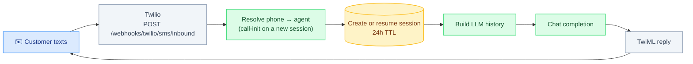

TurnCall supports text-based conversations via Twilio SMS and the Chat API. Agents use the same LLM configuration as voice but respond with text.

## SMS Flow



No Pipecat pipeline is involved — this is a text path through `services/`.

### Enable SMS on a Phone Number

Set `sms_enabled: true` when binding a phone number. TurnCall auto-configures the Twilio SMS webhook.

The same number handles both voice calls and SMS.

A number routed to call-init (`routing_target_type: "webhook"`) asks your server
which agent answers, once per conversation, and keeps its `variables` and
`knowledge_context` for every reply. See [Pre-Call Init](/guides/call-init#text-conversations-sms-whatsapp-text).

## Chat API

Use the Chat API for programmatic text conversations:

```bash
# Send a message
curl -X POST http://localhost:8090/v1/chat \
  -H "Authorization: Bearer tc_xxx" \
  -H "Content-Type: application/json" \
  -d '{
    "agent_id": "AGENT_ID",
    "message": "What are your hours?",
    "customer_number": "+15559876543",
    "turncall_number": "+15551234567"
  }'
```

### Template variables

`variables` fill `{{placeholders}}` in the agent's system prompt and tool
descriptions, as call-init's do on a call. They are kept on the session and
merged: send them on any message, a name sent again replaces its value, and a
message without them leaves them as they are. The agent's own `metadata` fills
any name the session does not set.

```bash
curl -X POST http://localhost:8090/v1/chat \
  -H "Authorization: Bearer tc_xxx" \
  -H "Content-Type: application/json" \
  -d '{
    "agent_id": "AGENT_ID",
    "message": "Where is my order?",
    "variables": {"name": "Jane", "address": "12 Herzl St"}
  }'
```

At most 50 names and 4,096 characters, names included — per request (`422`)
and for the session they add up to (`400`).

### Endpoints

| Method | Path | Description |
|--------|------|-------------|
| POST | `/v1/chat` | Send message, get LLM reply |
| GET | `/v1/chat/sessions` | List sessions |
| GET | `/v1/chat/sessions/:id` | Get session detail |
| GET | `/v1/chat/sessions/:id/messages` | List messages |
| DELETE | `/v1/chat/sessions/:id` | Expire session |

The two lists take `limit` (sessions: 50 by default, messages: 100) up to 500; a larger one is cut to 500, and the response's `limit` is the one applied.

## Context Threading

Use `session_id` (group messages) or `previous_chat_id` (linear chain) to maintain conversation context. Cannot use both.

## Session Management

- **Auto-created** on first inbound SMS or Chat API call
- **Resumed** if same (customer_number, turncall_number) pair and &lt;24h since last activity
- **Expired** after 24h inactivity (lazy on lookup + background cleanup every 15 min)
- **Holds the agent's skills**: resolved on the session's first message, and a skill loaded in one message stays loaded for the next. See [Skills in a text conversation](/guides/skills#skills-in-a-text-conversation)
- **Rate-limited** by the project's `messages_per_minute`, if set: past it the Chat API answers `429 rate_limited`, and an SMS or WhatsApp message is not answered or sent to the LLM. See [Limits](/guides/limits#messages-per-minute)

### Webhook Events

- `session.created`
- `session.updated`
- `session.deleted`
- `chat.created`

With [redaction](/guides/redaction) on, these payloads are redacted before they are sent, `customer_number` and `turncall_number` included. See [Redaction](/guides/server-events#redaction) in Server Events.
